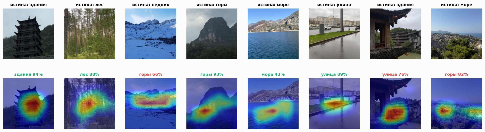
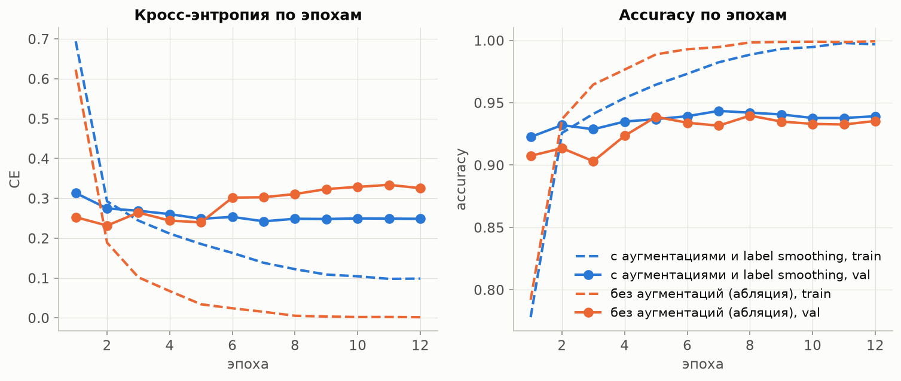
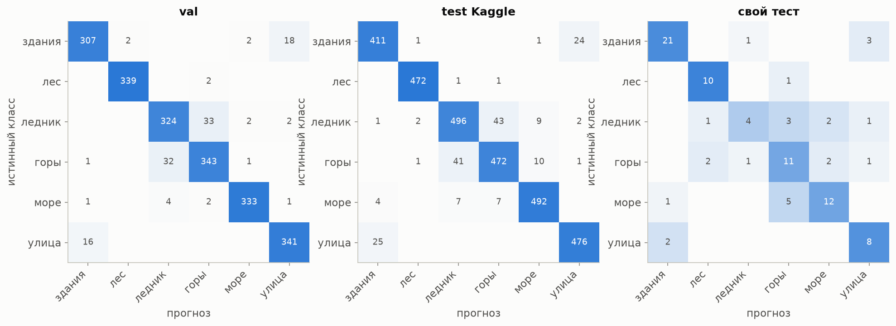
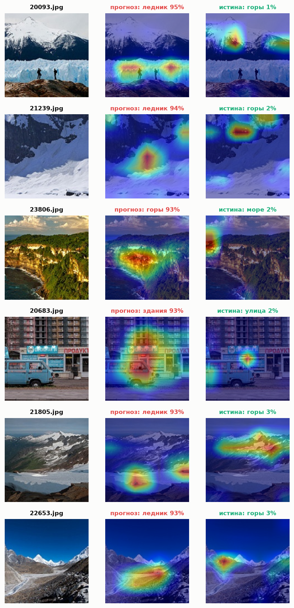
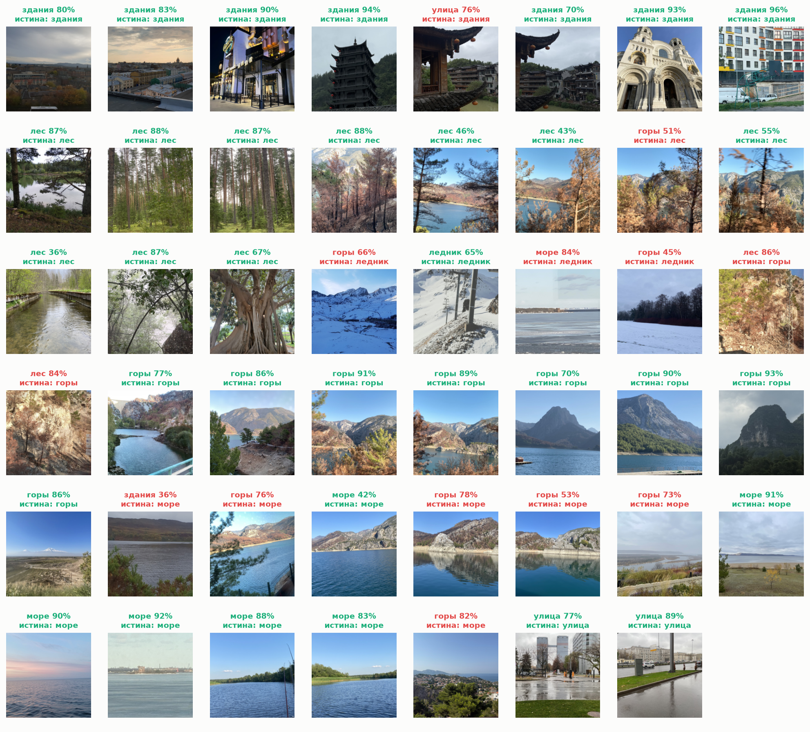

# Классификация сцен свёрточной сетью: город и природа

Лабораторная работа №3.1 по курсу «Системы компьютерной обработки изображений».
Выполнил: Яснов Михаил Андреевич, группа P3417.

Сеть ResNet-50 с весами ImageNet я дообучил на 11 928 снимках Intel Image Classification различать шесть сцен: здания, лес, ледник, горы, море и улицу. Обучение заняло 4,8 минуты на NVIDIA A10. На 3000 тестовых снимках Kaggle accuracy 0,940 и macro-F1 0,941, а на 92 моих фотографиях с телефона та же сеть угадывает 71,7 %. CLIP без всякого обучения даёт на снимках Kaggle те же 0,941, а на моих фото 79,4–83,7 %. Тепловые карты Grad-CAM показывают, куда сеть смотрит, и находят в тесте Kaggle ошибки разметки.



- [Как запустить](#как-запустить)
- [1. Теоретическая база](#1-теоретическая-база)
- [2. Описание разработанной системы](#2-описание-разработанной-системы)
- [3. Результаты работы и тестирования](#3-результаты-работы-и-тестирования)
- [4. Выводы](#4-выводы)
- [5. Использованные источники](#5-использованные-источники)

## Как запустить

```bash
python -m venv .venv && source .venv/bin/activate
pip install -r requirements.txt
python -m pytest -q                        # 27 тестов, около 10 с

python prepare_data.py --download          # датасет через Kaggle API, нужен ~/.kaggle/kaggle.json
python train.py                            # основной прогон -> checkpoints/resnet50.pt
python train.py --name resnet50_noaug --no-augment --label-smoothing 0     # абляция
python evaluate.py                         # метрики, кривые, матрицы ошибок -> results/
python clip_eval.py                        # CLIP zero-shot, linear probe, тест Макнемара
python gradcam_report.py                   # тепловые карты
python benchmark.py                        # скорость на текущем устройстве

python predict.py photo.jpg --top 3 --gradcam cam.png
```

Свой тест кладётся в `data/own_test/<класс>/`, после этого нужно заново запустить `prepare_data.py`. Чекпойнты (по 96 МБ) и фотографии в репозиторий не входят.

## 1. Теоретическая база

### 1.1. Свёрточная сеть

Свёрточный слой проходит по карте признаков $X$ с $C$ каналами набором фильтров $W_k$ размером $C \times h \times w$:

```math
Y_k(i, j) = b_k + \sum_{c=1}^{C} \sum_{u=1}^{h} \sum_{v=1}^{w} W_k(c, u, v)\, X(c,\, i + u,\, j + v).
```

Один и тот же фильтр применяется во всех точках, поэтому параметров мало и объект распознаётся в любом месте кадра. После свёртки стоит ReLU, $\max(0, x)$. Пулинг или свёртка с шагом 2 уменьшают карту вдвое. Первые слои реагируют на края и цветовые пятна, глубокие на текстуры и части объектов [1, 2]. На выходе карта признаков усредняется по пространству, и полносвязный слой выдаёт по одному числу (логиту) на класс.

### 1.2. ResNet

Простую сеть нельзя бесконечно углублять: на CIFAR-10 обычная сеть из 56 слоёв ошибается даже на обучающей выборке чаще, чем сеть из 20 слоёв [3]. ResNet решает это остаточными связями. Блок учит не само отображение, а поправку к своему входу: $y = F(x) + x$. Если блок не нужен, ему достаточно обнулить $F$, и градиент проходит по прямой связи без затухания. ResNet-50 собрана из 16 блоков вида 1×1 -> 3×3 -> 1×1 свёртки, на входе 224×224 последняя карта имеет размер 2048×7×7. С новым слоем на 6 классов в сети 23,5 млн параметров.

### 1.3. Перенос обучения

Учить 23,5 млн параметров с нуля на 12 тысячах снимков бессмысленно, сеть их просто запомнит. Поэтому берутся веса, обученные на ImageNet (1,28 млн снимков, 1000 классов) [4]. Последний слой меняется на новый. Дальше с небольшим шагом дообучается вся сеть. Признаки ранних слоёв годятся почти для любых фотографий, а чем точнее модель на ImageNet, тем лучше она переносится на другие задачи [5].

### 1.4. Функция потерь

Softmax переводит логиты $z_k$ в вероятности $p_k = e^{z_k} / \sum_j e^{z_j}$, а кросс-энтропия штрафует за малую вероятность правильного класса:

```math
L = -\sum_{k=1}^{K} q_k \log p_k, \qquad q_k = (1 - \varepsilon)\,[k = y] + \frac{\varepsilon}{K}.
```

При $\varepsilon = 0$ вся масса $q$ стоит на правильном классе $y$. Label smoothing [6] с $\varepsilon = 0{,}1$ и $K = 6$ оставляет правильному классу 0,917, а остальным по 0,017. Сеть перестаёт разгонять логиты до бесконечности, и её уверенность лучше совпадает с реальной долей верных ответов [7]. Минимум сглаженной функции потерь больше нуля, поэтому на графиках и в таблицах везде указана обычная кросс-энтропия (CE) без сглаживания.

### 1.5. Метрики

Accuracy равна доле верных ответов. Для класса $k$ точность (precision) равна $TP/(TP + FP)$, полнота (recall) равна $TP/(TP + FN)$, $F_1 = 2PR/(P + R)$. Macro-F1 усредняет $F_1$ по классам с равными весами: на своём тесте классы неравные, и accuracy там завышает вклад самого частого. Матрица ошибок показывает, какие классы с какими путаются. Лучшая эпоха выбирается по macro-F1 на валидации.

Чтобы сравнить два классификатора на одних и тех же снимках, я использую точный тест Макнемара [8]. Считаются снимки, где верен только первый ($b$) и только второй ($c$). Если классификаторы равны по качеству, $b$ распределено биномиально с параметрами $b + c$ и 1/2, и двусторонний p-value равен $\min\bigl(1,\ 2 \sum_{i \le \min(b,c)} \binom{b+c}{i} 2^{-(b+c)}\bigr)$.

### 1.6. Переобучение

Переобученная модель запоминает обучающие снимки вместо общих признаков сцены. Признаки этого такие: accuracy на train идёт к 100 %, а функция потерь на валидации проходит минимум и начинает расти. У меня против этого четыре средства: аугментации (случайная вырезка 60–100 % площади, отражение, сдвиг яркости и цвета), label smoothing, штраф на веса в AdamW [9] и выбор лучшей эпохи по валидации. Чтобы было видно, от чего они защищают, второй прогон обучен без аугментаций и без сглаживания.

### 1.7. Grad-CAM

Grad-CAM [10] показывает, на какую часть снимка опирается ответ. Берутся карты последнего свёрточного блока $A^k$ (в ResNet-50 это `layer4`, 2048 карт 7×7) и градиент логита класса $c$ по ним. Усреднённый по карте градиент даёт её вес, а взвешенная сумма карт после ReLU даёт тепловую карту 7×7, которую растягивают до размера снимка:

```math
\alpha_k^c = \frac{1}{49} \sum_{i,j} \frac{\partial y^c}{\partial A^k_{ij}}, \qquad L^c = \mathrm{ReLU}\Bigl(\sum_k \alpha_k^c A^k\Bigr).
```

### 1.8. CLIP

CLIP [11] состоит из двух сетей, для изображений и для текста. Их учили на сотнях миллионов пар из снимка и подписи так, чтобы векторы подходящих пар были близки. Классификатор из CLIP получается без обучения (zero-shot): каждый класс описывается фразой вроде «a photo of a forest.», и выбирается класс, чей текстовый вектор ближе всего к вектору снимка по косинусу. Если усреднить векторы нескольких формулировок (ансамбль шаблонов), ответ меньше зависит от удачной фразы. Есть и промежуточный способ, linear probe: CLIP заморожен, а по его векторам обучающих снимков учится логистическая регрессия. Я беру открытые веса OpenCLIP, обученные на 2 млрд пар LAION-2B [12]: ViT-B/32 и ViT-L/14.

## 2. Описание разработанной системы

### 2.1. Архитектура

```
lab3/
├── classifier/
│   ├── data.py           список снимков, разбиение, трансформации, загрузчики
│   ├── model.py          ResNet-50 с новым слоем, чекпойнты, выбор устройства
│   ├── engine.py         эпоха обучения со смешанной точностью, предсказание
│   ├── metrics.py        accuracy, macro-F1, матрица ошибок, метрики по классам
│   ├── gradcam.py        Grad-CAM на хуках PyTorch и наложение карты на снимок
│   └── clip_zeroshot.py  CLIP: текстовые векторы классов и классификация
├── prepare_data.py       скачивание, разбиение train/val, проверка своего теста
├── train.py              обучение -> checkpoints/, results/history_*.csv
├── evaluate.py           метрики, кривые, матрицы ошибок -> results/
├── clip_eval.py          CLIP zero-shot, linear probe, тест Макнемара -> results/
├── gradcam_report.py     тепловые карты -> results/
├── benchmark.py          скорость и память -> results/speed.csv
├── predict.py            консольная программа
├── plot_style.py, tests/
└── results/              таблицы, графики, предсказания по каждому снимку
```

### 2.2. Данные

В Intel Image Classification [13] 14 034 размеченных снимка 150×150 в `seg_train`, 3000 в `seg_test` и 7301 неразмеченный в `seg_pred`, его я не использую. Классы сбалансированы, в train на класс приходится от 1862 до 2135 снимков.

| Выборка | Откуда | Снимков |
|:---|:---|---:|
| train | 85 % `seg_train`, разбиение по классам, seed 0 | 11 928 |
| val | остальные 15 % `seg_train` | 2 106 |
| test Kaggle | `seg_test`, не участвует ни в обучении, ни в выборе эпохи | 3 000 |
| свой тест | мои фото с телефона | 92 |

Свой тест собран из 92 моих фото из поездок и прогулок, в основном HEIC с iPhone: 25 зданий, 11 лесов, 11 снежных и ледяных сцен, 17 гор, 18 водоёмов и 10 улиц. Я перевёл их в JPG (`sips`), уменьшил до 1024 px по длинной стороне и разметил вручную по одному правилу: класс задаёт сцена, которая занимает большую часть кадра. Люди на переднем плане допустимы, если сцена за ними читается. Классов в Intel всего шесть, поэтому озёра и реки я отнёс к морю, а снег и лёд вне ледников (заснеженные склоны, парк под снегом, замёрзший залив) к леднику. От снимков Intel эти фото отличаются сильно: есть ночная съёмка, люди в кадре, вертикальная ориентация, китайская архитектура. Метрики посчитаны по всем 92 фото, а на рисунках отчёта только 47 пейзажей без людей.

### 2.3. Модель и обучение

| Параметр | Значение |
|:---|:---|
| Сеть | ResNet-50, веса `IMAGENET1K_V2` из torchvision [14], новый слой 2048 -> 6, дообучается вся сеть |
| Вход | 224×224, нормализация ImageNet; на оценке сжатие по короткой стороне и вырезка центра |
| Аугментации | RandomResizedCrop с площадью 60–100 %, отражение по горизонтали, ColorJitter 0,2 |
| Функция потерь | кросс-энтропия с label smoothing 0,1 |
| Оптимизатор | AdamW, шаг 3·10⁻⁴, weight decay 10⁻⁴ |
| Расписание | линейный прогрев первую эпоху, дальше косинус до нуля |
| Эпох и размер пакета | 12 и 64 |
| Вычисления | смешанная точность fp16 на GPU |
| Выбор чекпойнта | лучшая эпоха по macro-F1 на val |
| Метрики | accuracy, macro-F1, precision, recall и F1 по классам, матрица ошибок |

### 2.4. Консольная программа

```
$ python predict.py sea.jpg --top 3
sea.jpg
  1. море (sea): 71.3%
  2. улица (street): 10.6%
  3. горы (mountain): 8.6%
```

С флагом `--gradcam cam.png` программа рисует для каждого снимка тепловую карту предсказанного класса. Неверные аргументы она отклоняет одной строкой до загрузки модели, например HEIC: формат нужно сначала перевести в JPG. 27 тестов проверяют разбиение и его повторяемость, поворот по EXIF, форму входа и выхода сети, сохранение и загрузку чекпойнта, метрики и тест Макнемара на известных примерах, снижение функции потерь при обучении на синтетике, форму карты Grad-CAM, CLIP со случайными весами, отбор снимков для сетки, `prepare_data.py` и аргументы CLI.

### 2.5. Системные требования

| Задача | Что нужно | Что измерено |
|:---|:---|:---|
| Обучение, 12 эпох | GPU NVIDIA с CUDA и 6 ГБ памяти | A10: PyTorch выделял до 3,1 ГБ, nvidia-smi показывал 5,3 ГБ; 23 с на эпоху, 4,8 мин на прогон |
| CLIP на всех выборках | желательно GPU: на CPU M4 ViT-L/14 тратит 0,2–0,36 с на снимок | A10: векторы ViT-L/14 для val, теста Kaggle и своего теста за 93 с, пакет 64 в fp32 занимает 1,9 ГБ |
| `predict.py` | любой процессор, 0,6 ГБ ОЗУ | M4: 18 мс на снимок на CPU, 8 мс на MPS, вместе с запуском Python 2,4 с |
| Диск | 3,8 ГБ на Mac, 8 ГБ с CUDA; для одного `predict.py` хватит 1,1 ГБ | датасет 400 МБ, два чекпойнта по 96 МБ, веса CLIP 578 МБ и 1,6 ГБ, окружение 0,95 ГБ на Mac и 5,4 ГБ с CUDA |

Проверено на двух стендах. Сервер: NVIDIA A10 24 ГБ, Ubuntu, Python 3.12, PyTorch 2.5.1 с CUDA 12.1. Ноутбук: Apple M4 16 ГБ, macOS 26, Python 3.13, PyTorch 2.15. Обучение на M4 я не запускал. Окружение на сервере стоит делать изолированным: с `--system-site-packages` в него попал cuDNN 9.19 для CUDA 13 из `~/.local`, и PyTorch с CUDA 12.1 падал с `CUDNN_STATUS_NOT_INITIALIZED` на первой же свёртке, хотя память на обеих картах была свободна. Помогло только пересоздать окружение без чужих пакетов.

Скорость сети без загрузки снимков ([`results/speed.csv`](results/speed.csv)). У CLIP учтён только кодировщик изображений: текстовые векторы классов считаются один раз.

| Модель | Параметров, млн | A10, 1 снимок, мс | A10, fp16, пакет 64, снимков/с | M4 MPS, 1 снимок, мс | M4 CPU, 1 снимок, мс |
|:---|---:|---:|---:|---:|---:|
| ResNet-50 | 23.5 | 5.2 | 1358 | 8.2 | 17.9 |
| CLIP ViT-B/32 | 87.8 | 5.4 | 1475 | 8.2 | 19.3 |
| CLIP ViT-L/14 | 304.0 | 48.0 | 216 | 85.9 | 199.9 |

ViT-L/14 на процессоре M4 нестабилен: в двух запусках 200 и 357 мс. На MPS он пакетом 64 работает медленнее, чем по одному снимку (6 против 12 снимков в секунду), поэтому пакетов для Mac в таблице нет.

## 3. Результаты работы и тестирования

Все числа взяты из [`results/metrics.md`](results/metrics.md), [`results/per_class.md`](results/per_class.md), [`results/clip.md`](results/clip.md) и [`results/mcnemar.md`](results/mcnemar.md). Предсказание для каждого снимка лежит в `results/predictions_*.csv`.

### 3.1. Обучение и переобучение



| Выборка | С аугментациями: acc | F1 | CE | Без аугментаций: acc | F1 | CE |
|:---|---:|---:|---:|---:|---:|---:|
| train (режим eval) | 0.9961 | 0.9961 | 0.111 | 0.9993 | 0.9993 | 0.001 |
| val | 0.9435 | 0.9446 | 0.242 | 0.9397 | 0.9404 | 0.311 |
| test Kaggle | 0.9397 | 0.9409 | 0.252 | 0.9437 | 0.9448 | 0.277 |
| свой тест | 0.7174 | 0.6929 | 0.874 | 0.6848 | 0.6766 | 2.092 |

Train здесь заново прогнан через сеть в режиме оценки, без аугментаций, иначе сравнение с val нечестное. Основной прогон обучающую выборку запомнил: 99,6 % на train против 94,4 % на val, разрыв 5,3 п.п. Но вреда от этого нет. После пятой эпохи CE на val стоит на 0,242–0,253, хотя на train продолжает падать с 0,185 до 0,099. Лучшей оказалась эпоха 7.

Без аугментаций и сглаживания переобучение видно сразу. CE на train падает до 0,002, а на val после минимума 0,232 на второй эпохе растёт до 0,334 к одиннадцатой. Accuracy при этом почти не меняется: сеть отвечает так же, только всё увереннее, в том числе когда ошибается. На тесте Kaggle основная сеть ошиблась с уверенностью выше 90 % на 23 снимках из 181 неверного, а абляция на 112 из 169. На своих фото средняя уверенность в неверном ответе 0,66 против 0,87, а выше 90 % основная сеть ошиблась 2 раза из 26, абляция 17 раз из 29. Отсюда CE 0,874 против 2,092.

По accuracy аугментации ничего не дали. На тесте Kaggle абляция даже выше на 0,4 п.п., но при 3000 снимках стандартная ошибка accuracy как раз около 0,4 п.п., так что это шум. В этой задаче регуляризация работает на калибровку, а не на точность.

### 3.2. Тест Kaggle



| Класс | Precision | Recall | F1 | Снимков |
|:---|---:|---:|---:|---:|
| здания | 0.932 | 0.941 | 0.936 | 437 |
| лес | 0.992 | 0.996 | 0.994 | 474 |
| ледник | 0.910 | 0.897 | 0.903 | 553 |
| горы | 0.902 | 0.899 | 0.901 | 525 |
| море | 0.961 | 0.965 | 0.963 | 510 |
| улица | 0.946 | 0.950 | 0.948 | 501 |

Из 181 ошибки 84 (46 %) приходятся на пару «ледник и горы», ещё 49 (27 %) на пару «здания и улица». В Intel у каждого снимка одна метка, а сцены смешанные: снежная гора подходит под оба класса, улица всегда состоит из зданий. Val и тест Kaggle отличаются на 0,4 п.п., значит выбор эпохи по val почти не завысил оценку.

### 3.3. Grad-CAM



Здесь шесть самых уверенных ошибок на тесте Kaggle. В среднем столбце карта для ответа сети, в правом карта для истинного класса. 20093.jpg я считаю ошибкой разметки: в кадре ледяная стена ледника и два человека перед ней, метка «горы». Сеть отвечает «ледник» с уверенностью 95 % и смотрит ровно на лёд. На 21805.jpg и 22653.jpg карта ответа лежит в нижней части кадра, на льду и в долине, а карта для «гор» на вершинах. На 20683.jpg метка «улица», а сеть выбирает «здания», глядя на многоэтажку и фургон.

На своих фото (рисунок в начале) сеть смотрит туда же, куда и человек, пока сцена похожа на Intel: пагода, стволы сосен, скала, вода, мокрая дорога. Ошибки на картах тоже объяснимы. На заснеженном курорте сеть смотрит на склоны с гребнем и отвечает «горы» (66 %), и метка «ледник» здесь спорна так же, как на тесте Kaggle. С карнизом китайского дома карта уходит на дома у реки, ответ «улица». Марсель с холма сеть считает горами: склона и сосен в кадре больше, чем моря.

### 3.4. Свой тест



На 92 своих фото accuracy 0,717 и macro-F1 0,693, на 22,2 п.п. ниже, чем на тесте Kaggle. Хуже всего с ледником: 7 из 11 снимков ушли в другие классы (recall 0,364). Все 26 ошибок я разобрал вручную:

| Причина | Ошибок | Примеры |
|:---|---:|:---|
| в кадре два класса | 10 | озеро в горах -> горы, сгоревший лес на склоне -> лес или горы |
| снег и лёд вне ледника | 7 | заснеженный склон -> горы, замёрзший залив -> море, парк под снегом -> лес |
| здания или улица | 5 | карниз над домами у реки -> улица, ночные витрины -> здания |
| человек закрывает сцену | 4 | групповое фото на фоне Арарата -> улица |

Первые две причины упираются в сами классы. Озеро в горах или сгоревший лес на склоне честно подходят под два класса сразу, и мою метку можно оспорить. Метки я ставил до запуска моделей и после не менял, иначе тест подстроился бы под ответы. Ещё одна мелочь: при вертикальном кадре вырезка центра 224×224 срезает верх и низ, и от сцены остаётся полоса.

### 3.5. Дополнительно: CLIP без обучения

| Модель | Способ | val, acc | Тест Kaggle, acc | Тест Kaggle, F1 | Свой тест, acc | Свой тест, F1 |
|:---|:---|---:|---:|---:|---:|---:|
| ResNet-50 | дообучение всей сети | 0.9435 | 0.9397 | 0.9409 | 0.7174 | 0.6929 |
| CLIP ViT-B/32 | zero-shot, один шаблон | 0.9397 | 0.9377 | 0.9386 | 0.7826 | 0.7401 |
| CLIP ViT-B/32 | zero-shot, 7 шаблонов | 0.9449 | 0.9410 | 0.9419 | 0.7935 | 0.7506 |
| CLIP ViT-B/32 | linear probe | 0.9511 | 0.9517 | 0.9525 | 0.7391 | 0.7096 |
| CLIP ViT-L/14 | zero-shot, один шаблон | 0.9349 | 0.9383 | 0.9398 | 0.8370 | 0.7995 |
| CLIP ViT-L/14 | zero-shot, 7 шаблонов | 0.9383 | 0.9380 | 0.9391 | 0.8152 | 0.7706 |
| CLIP ViT-L/14 | linear probe | 0.9592 | 0.9570 | 0.9577 | 0.7717 | 0.7543 |

| Выборка | ResNet-50 против | Снимков | Верна только ResNet | Верен только CLIP | p (Макнемар) |
|:---|:---|---:|---:|---:|---:|
| тест Kaggle | CLIP ViT-B/32, 7 шаблонов | 3000 | 91 | 95 | 0.83 |
| тест Kaggle | CLIP ViT-L/14, 7 шаблонов | 3000 | 105 | 100 | 0.78 |
| свой тест | CLIP ViT-B/32, 7 шаблонов | 92 | 8 | 15 | 0.21 |
| свой тест | CLIP ViT-L/14, 7 шаблонов | 92 | 9 | 18 | 0.12 |

Классы описаны фразами «buildings», «a forest», «a glacier», «mountains», «the sea», «a city street», шаблоны вида «a photo of {}.», «a landscape photo of {}.», «a photo taken on a phone of {}.». CLIP ViT-B/32 не видел ни одного обучающего снимка Intel и всё равно набирает на тесте Kaggle 0,941, как дообученная ResNet-50. Тест Макнемара разницы между ними не находит (p = 0,83). На своих фото CLIP впереди: 0,794 у ViT-B/32 и 0,837 у ViT-L/14 с одним шаблоном против 0,717 у ResNet. Направление ожидаемое, ведь CLIP учился на 2 млрд подписанных фото из интернета, а ResNet видела только 12 тысяч кадров Intel размером 150×150. Но значимости нет: из 23 снимков, где права только одна модель, на CLIP ViT-B/32 приходится 15 (p = 0,21), у ViT-L/14 18 из 27 (p = 0,12). Ошибается CLIP на тех же развилках, что и ResNet, со снегом и смешанными кадрами, и при этом увереннее: с уверенностью выше 90 % у ViT-B/32 9 ошибок из 19, у ResNet 2 из 26.

Linear probe поверх ViT-L/14 дал лучший результат на тесте Kaggle: 0,957, на 1,7 п.п. выше ResNet-50. Логистическая регрессия учится на готовых векторах 11 928 обучающих снимков, коэффициент регуляризации $C = 10$ выбран по val из 0,1, 1, 10 и 100. Цена в размере. У ViT-L/14 в 13 раз больше параметров, чем у ResNet-50, и на M4 он в 10 раз медленнее (86 мс против 8 мс на снимок). ViT-B/32 по скорости не уступает ResNet-50, но его веса занимают 578 МБ против 96 МБ чекпойнта.


## 4. Выводы

1. ResNet-50 с весами ImageNet за 12 эпох (4,8 мин на A10) различает шесть сцен Intel с accuracy 0,940 и macro-F1 0,941 на тесте Kaggle. Почти половина ошибок приходится на пару «ледник и горы», и часть из них Grad-CAM показывает как ошибки разметки.
2. Основная модель запомнила train (99,6 % против 94,4 % на val), но CE на val не растёт, вредного переобучения нет. Без аугментаций и label smoothing CE на val растёт с 0,232 до 0,334, а уверенных ошибок впятеро больше: 112 против 23. Accuracy у обоих прогонов одинаковая.
3. На своих фото ResNet даёт 0,717, на 22,2 п.п. меньше, чем на тесте Kaggle. Больше всего ошибок там, где кадр честно подходит под два класса, и на снегу вне ледников: шесть классов Intel плохо покрывают реальные фото с телефона.
4. CLIP без обучения равен ResNet на тесте Kaggle (0,941 против 0,940, p = 0,83). На своих фото он впереди на 8–10 п.п., но на 92 снимках это не значимо (p = 0,21 и 0,12). Linear probe на ViT-L/14 лучший на тесте Kaggle: 0,957.
5. CLIP ViT-B/32 работает на M4 так же быстро, как ResNet-50 (8 мс на снимок), и обучать его не нужно, но ошибается он увереннее. Следующим шагом я бы расширил свой тест до 350 фото, чтобы проверить отрыв CLIP, и дообучил ResNet на смеси Intel и своих размеченных фото.

## 5. Использованные источники

1. LeCun Y., Bottou L., Bengio Y., Haffner P. Gradient-based learning applied to document recognition // Proceedings of the IEEE. — 1998. — Vol. 86, No. 11. — P. 2278–2324. — DOI: [10.1109/5.726791](https://doi.org/10.1109/5.726791).
2. Krizhevsky A., Sutskever I., Hinton G. E. ImageNet classification with deep convolutional neural networks // Communications of the ACM. — 2017. — Vol. 60, No. 6. — P. 84–90. — DOI: [10.1145/3065386](https://doi.org/10.1145/3065386).
3. He K., Zhang X., Ren S., Sun J. Deep Residual Learning for Image Recognition // 2016 IEEE Conference on Computer Vision and Pattern Recognition. — 2016. — P. 770–778. — DOI: [10.1109/CVPR.2016.90](https://doi.org/10.1109/CVPR.2016.90).
4. Deng J., Dong W., Socher R., Li L.-J., Li K., Fei-Fei L. ImageNet: A large-scale hierarchical image database // 2009 IEEE Conference on Computer Vision and Pattern Recognition. — 2009. — P. 248–255. — DOI: [10.1109/CVPR.2009.5206848](https://doi.org/10.1109/CVPR.2009.5206848).
5. Kornblith S., Shlens J., Le Q. V. Do Better ImageNet Models Transfer Better? // 2019 IEEE/CVF Conference on Computer Vision and Pattern Recognition. — 2019. — P. 2656–2666. — DOI: [10.1109/CVPR.2019.00277](https://doi.org/10.1109/CVPR.2019.00277).
6. Szegedy C., Vanhoucke V., Ioffe S., Shlens J., Wojna Z. Rethinking the Inception Architecture for Computer Vision // 2016 IEEE Conference on Computer Vision and Pattern Recognition. — 2016. — P. 2818–2826. — DOI: [10.1109/CVPR.2016.308](https://doi.org/10.1109/CVPR.2016.308).
7. Müller R., Kornblith S., Hinton G. E. When does label smoothing help? // Advances in Neural Information Processing Systems 32 (NeurIPS 2019). — 2019. — URL: https://proceedings.neurips.cc/paper/2019/hash/f1748d6b0fd9d439f71450117eba2725-Abstract.html.
8. McNemar Q. Note on the sampling error of the difference between correlated proportions or percentages // Psychometrika. — 1947. — Vol. 12, No. 2. — P. 153–157. — DOI: [10.1007/BF02295996](https://doi.org/10.1007/BF02295996).
9. Loshchilov I., Hutter F. Decoupled Weight Decay Regularization // International Conference on Learning Representations (ICLR 2019). — 2019. — URL: https://openreview.net/forum?id=Bkg6RiCqY7.
10. Selvaraju R. R., Cogswell M., Das A., Vedantam R., Parikh D., Batra D. Grad-CAM: Visual Explanations from Deep Networks via Gradient-Based Localization // 2017 IEEE International Conference on Computer Vision. — 2017. — P. 618–626. — DOI: [10.1109/ICCV.2017.74](https://doi.org/10.1109/ICCV.2017.74).
11. Radford A., Kim J. W., Hallacy C., Ramesh A., Goh G., Agarwal S., Sastry G., Askell A., Mishkin P., Clark J., Krueger G., Sutskever I. Learning Transferable Visual Models From Natural Language Supervision // Proceedings of the 38th International Conference on Machine Learning. PMLR 139. — 2021. — P. 8748–8763. — URL: https://proceedings.mlr.press/v139/radford21a.html.
12. Cherti M., Beaumont R., Wightman R., Wortsman M., Ilharco G., Gordon C., Schuhmann C., Schmidt L., Jitsev J. Reproducible Scaling Laws for Contrastive Language-Image Learning // 2023 IEEE/CVF Conference on Computer Vision and Pattern Recognition. — 2023. — P. 2818–2829. — DOI: [10.1109/CVPR52729.2023.00276](https://doi.org/10.1109/CVPR52729.2023.00276).
13. Intel Image Classification [Электронный ресурс]. — Kaggle. — URL: https://www.kaggle.com/datasets/puneet6060/intel-image-classification (дата обращения: 30.10.2026).
14. Torchvision Documentation. ResNet-50 [Электронный ресурс]. — URL: https://docs.pytorch.org/vision/stable/models/generated/torchvision.models.resnet50.html (дата обращения: 30.10.2026).
15. Ilharco G., Wortsman M., Carlini N., Taori R., Dave A., Shankar V., Namkoong H., Miller J., Hajishirzi H., Farhadi A., Schmidt L. OpenCLIP [Электронный ресурс]. — Zenodo, 2021. — DOI: [10.5281/zenodo.5143773](https://doi.org/10.5281/zenodo.5143773).
